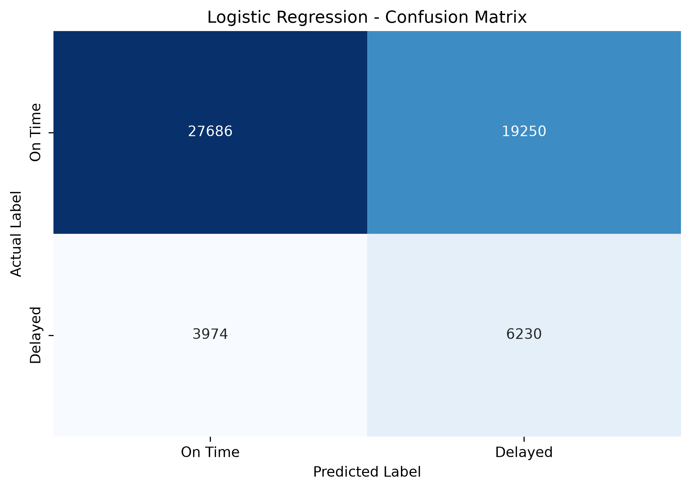
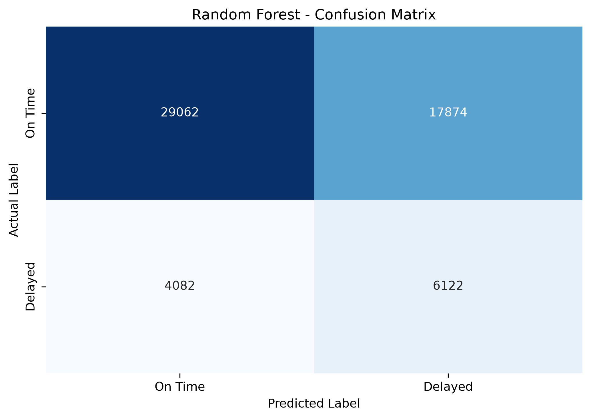
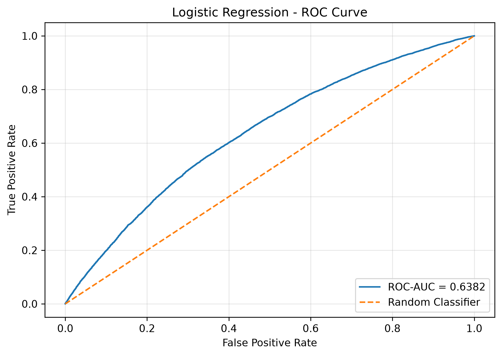
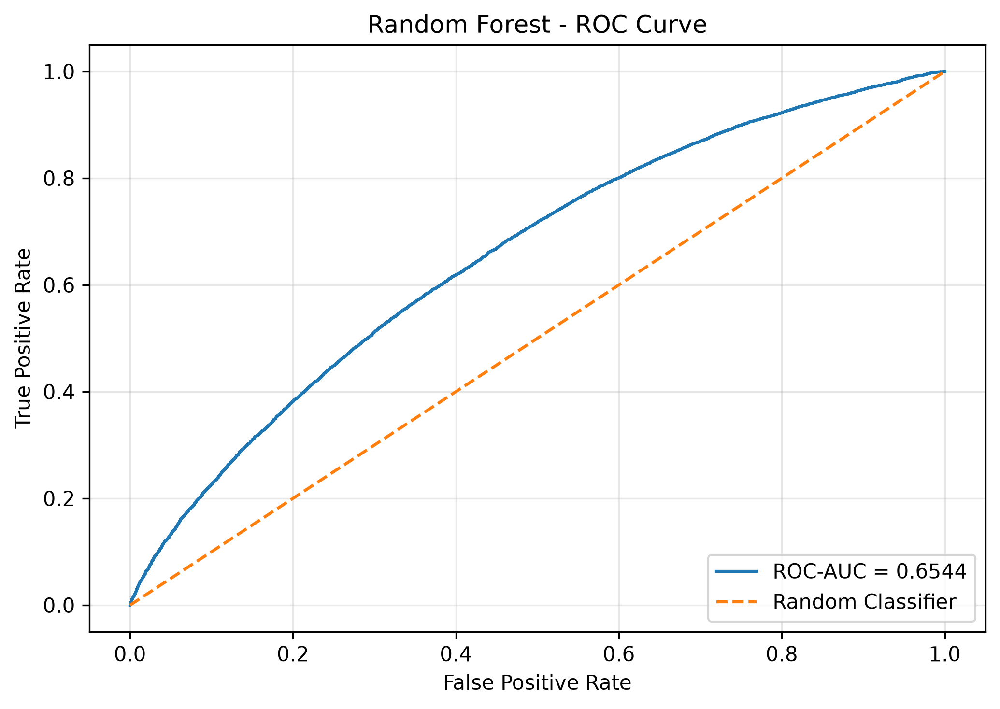

# Model Evaluation Report

## Project

Flight Delay Prediction Using Machine Learning

## Evaluation Objective

The objective is to compare Logistic Regression and Random Forest models for predicting whether a flight will arrive more than 15 minutes late.

## Evaluation Dataset

The training module draws a reproducible sample capped at 300,000 records from the feature-engineered dataset.

The sample is divided into training and testing sets using a stratified 80/20 split.

All evaluation metrics should be calculated using the held-out test dataset.

## Evaluation Metrics

### Accuracy

Measures the proportion of total predictions that are correct.

### Precision

Measures the proportion of flights predicted as delayed that were actually delayed.

### Recall

Measures the proportion of actual delayed flights correctly identified by the model.

### F1-score

Represents the harmonic mean of precision and recall.

### ROC-AUC

Measures the model's ability to rank positive cases above negative cases across different classification thresholds.

ROC-AUC should not be interpreted as prediction accuracy.

## Model Comparison

| Metric | Logistic Regression | Random Forest |
|---|---:|---:|
| Accuracy | 0.5936 | **0.6158** |
| Precision (delayed) | 0.2445 | **0.2551** |
| Recall (delayed) | **0.6105** | 0.6000 |
| F1-score (delayed) | 0.3492 | **0.3580** |
| ROC-AUC | 0.6382 | **0.6544** |

## Confusion Matrix Analysis

The held-out set contained 46,936 on-time and 10,204 delayed flights. Rows below are actual classes and columns are predicted classes, ordered On Time then Delayed.

| Model | True negatives | False positives | False negatives | True positives |
|---|---:|---:|---:|---:|
| Logistic Regression | 27,686 | 19,250 | 3,974 | 6,230 |
| Random Forest | 29,062 | 17,874 | 4,082 | 6,122 |

Logistic Regression identifies 108 more delayed flights than Random Forest, with 3,974 false negatives compared with 4,082. Random Forest has 1,376 fewer false positives (17,874 vs. 19,250). Both models miss a substantial number of actual delays and incorrectly flag many on-time flights.

## ROC Curve Analysis

Random Forest has a ROC-AUC of 0.6544, compared with 0.6382 for Logistic Regression. Both scores are above the 0.50 random-ranking baseline, but indicate modest ability to distinguish delayed from on-time flights; ROC-AUC is not accuracy.

## Model Selection

**Selected Model: Random Forest.** Its F1-score of 0.3580 is higher than Logistic Regression's 0.3492, so the configured selection rule chooses Random Forest without needing the ROC-AUC tie-breaker. Random Forest also has higher accuracy, precision, and ROC-AUC. Logistic Regression's delayed-class recall is slightly higher (0.6105 vs. 0.6000), which may be preferable when avoiding missed delays is the priority. Precision is low for both models (0.2445 and 0.2551), so many predicted delays are false alarms.

The selection is a metric-based comparison on this holdout set, not evidence that Random Forest is best for every operational use. The acceptable precision/recall balance depends on the costs of missed delays versus false alerts.

## Limitations

- Evaluation is based on a sample capped at 300,000 records.
- The random train-test split is stratified but not time-based.
- Weather forecast features are not included.
- Performance may vary across airlines, airports, routes, and time periods.

## Conclusion

On the sampled stratified holdout set, Random Forest has the best F1-score (0.3580) and ROC-AUC (0.6544), while Logistic Regression has marginally higher recall for delayed flights (0.6105). Both models have low delayed-flight precision and miss around 40% of actual delays. Results should be validated on a chronological holdout and across airlines, routes, and time periods before operational use.